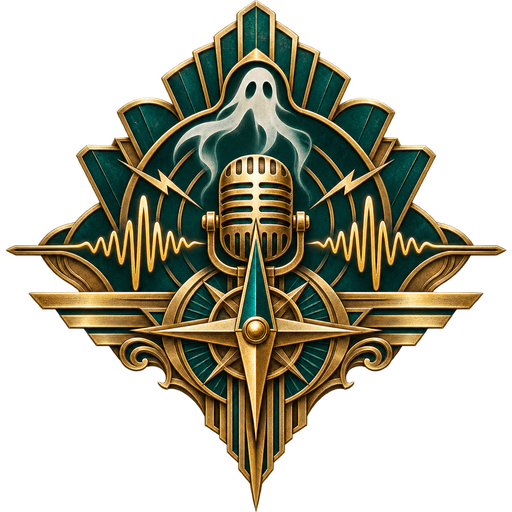

<div align="center">



# GHOST SIGNAL

### Каждое дело оставляет след в помехах.

**Нуарная детективная игра о расследованиях, свидетельствах и цене правды.**

[Играть локально](#-быстрый-запуск) · [Документация](#-документация) · [Дорожная карта](docs/REFACTORING_ROADMAP.md)

[](https://github.com/DoctorStrangeSH/GhostSignal/actions/workflows/quality.yml)
[](https://github.com/DoctorStrangeSH/GhostSignal/actions/workflows/visual-smoke.yml)


</div>

---

## О проекте

**Ghost Signal** — интерактивная детективная игра в эстетике городского нуара. Игрок расследует преступления, исследует места событий, разговаривает со свидетелями, сопоставляет документы и строит собственные версии.

Здесь важно не просто найти нужный предмет. Нужно понять, кто его оставил, откуда получены показания, насколько независимы источники и что произойдёт с людьми после принятого решения.

> Не каждое признание означает всю правду. Не каждое совпадение — доказательство.

## Игровые системы

| Система | Что делает |
| --- | --- |
| **Расследования** | Отдельные дела со своими персонажами, уликами, локациями и исходами |
| **Исследование** | Карта города, доступность мест и предметов, временные ограничения |
| **Диалоги и допросы** | Ветвящиеся разговоры, реакции на улики и противоречия |
| **Память NPC** | Персонажи учитывают прошлые разговоры, доверие и поступки детектива |
| **Доска расследования** | Собственные гипотезы, связи с источниками и проверка хронологии |
| **Улики и документы** | Осмотр, заметки, цепочки доказательств и происхождение показаний |
| **Последствия** | Обещания, репутация, отношения и разные варианты завершения дела |
| **Мини-игры** | Небольшие интерактивные задачи внутри расследований |

## Визуальное направление

Ghost Signal использует авторскую нуарную стилистику: тёмные архивные поверхности, выразительные портреты, бумажные материалы, фотографии и акцентный свет.

<div align="center">
  
  <sub>Атмосфера рабочего места детектива</sub>
</div>

## Быстрый запуск

### Требования

- Node.js **20 или новее**.
- Современный браузер.
- npm входит в комплект Node.js.

Сторонние npm-зависимости для запуска игры не нужны.

### Запустить игру

```bash
git clone https://github.com/DoctorStrangeSH/GhostSignal.git
cd GhostSignal
npm start
```

Откройте **http://127.0.0.1:4173**.

Для разработки на порту 3000:

```bash
npm run dev
```

## Проверки качества

Перед отправкой изменений запускайте полный набор:

```bash
# Синтаксис JavaScript
npm run check

# Ссылки и согласованность игровых данных
npm run validate:data

# Модульные и регрессионные тесты
npm test

# Полный набор проверок
npm run build
```

GitHub Actions запускает проверки качества и браузерный Visual Smoke для pull request в `main`.

## Архитектура репозитория

```text
GhostSignal/
├── assets/
│   ├── art/              # Иллюстрации, портреты и игровые фоны
│   ├── css/              # Стили и визуальные компоненты
│   ├── data/
│   │   ├── cases/        # Автономные пакеты расследований
│   │   ├── shared/       # Общие NPC и диалоги
│   │   └── narrative/    # Заметки и газетные материалы
│   └── js/
│       ├── core/         # Приложение, события и сохранения
│       ├── controllers/  # Координация игровых процессов
│       ├── npc/          # Диалоги, звонки и память персонажей
│       ├── systems/      # Игровая логика
│       └── ui/           # Интерфейс
├── docs/                 # ТЗ, дорожная карта и инструкции
├── scripts/              # Проверки и локальный сервер
├── tests/                # Автоматические тесты
├── index.html
└── package.json
```

## Документация

- [Дорожная карта и критерии версии 1.0](docs/REFACTORING_ROADMAP.md)
- [Передача контекста и следующий шаг](docs/SESSION_HANDOFF.md)
- [Гигиена репозитория и аудит](docs/REPOSITORY_HYGIENE.md)
- [Создание пакетов расследований](docs/CASE_PACK_AUTHORING.md)
- [Архитектура долговременной памяти NPC](docs/NPC_LONG_TERM_MEMORY.md)
- [Как расширять игру после 1.0](docs/POST_1_0_EXTENSION_GUIDE.md)

## Принципы разработки

1. **Сначала доказательства, потом выводы.** Система не должна подменять расследование догадкой.
2. **Происхождение важнее количества.** Несколько пересказов одного источника не становятся независимыми свидетельствами.
3. **NPC — не декорации.** Персонажи помнят поступки детектива и реагируют на них.
4. **Сохранение не должно менять историю.** Восстановление диалога не повторяет награды, эффекты и продвижение времени.
5. **Каждое дело изолировано.** Новые расследования должны добавляться отдельными пакетами без копирования общих систем.
6. **Изменения проверяются.** Новая механика сопровождается тестами и обновлением документации.

## Статус проекта

Ghost Signal находится в активной разработке. Версия **1.0 ещё не объявлена готовой**: перед релизом необходимо завершить сквозную браузерную приёмку существующих расследований, проверить все ключевые исходы и закрыть оставшиеся пункты дорожной карты.

Новые расследования и крупные функции после 1.0 должны добавляться как расширения существующей архитектуры, а не как бесконечный рефакторинг основы.

---

<div align="center">
  **GHOST SIGNAL** · Истина всегда оставляет след.
</div>
